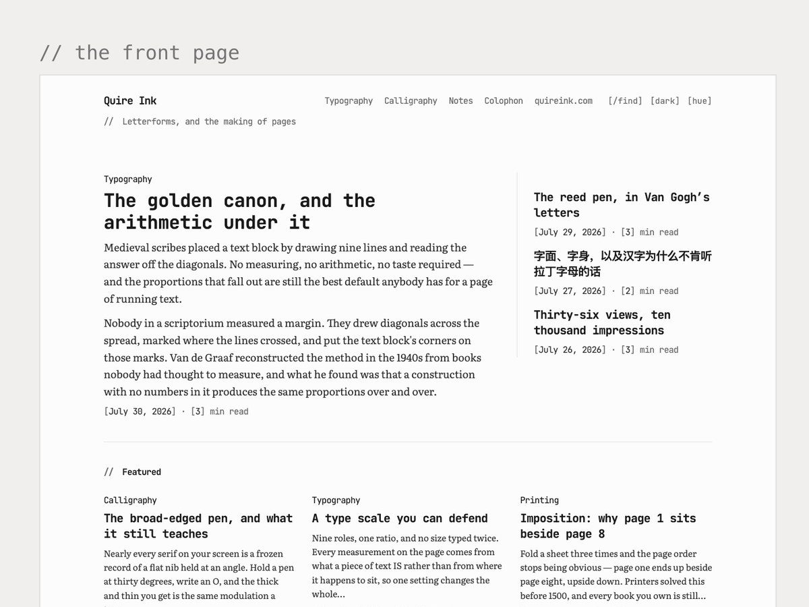
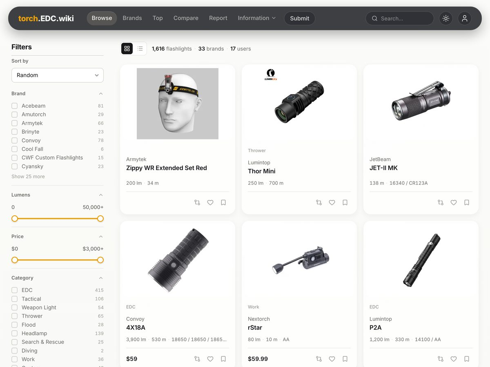
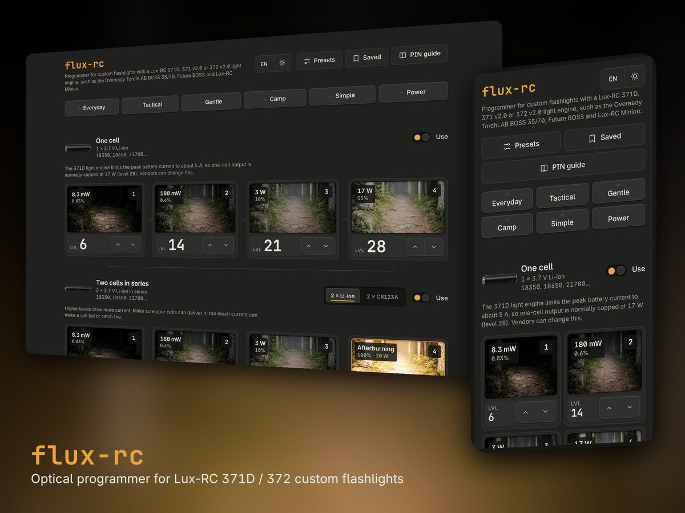
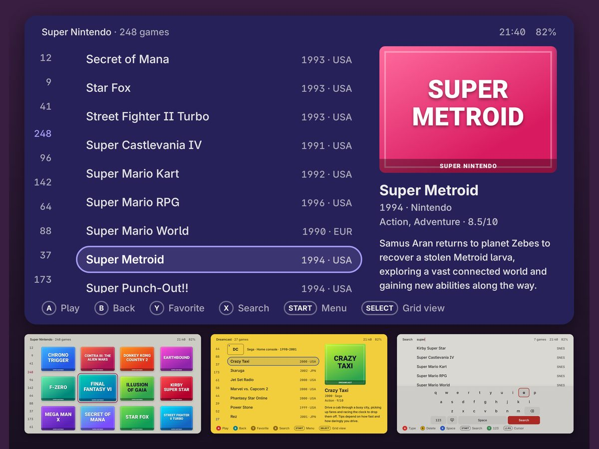

# Steven Tran (Trần Mạnh Hùng)

I make small things you can hold, mostly keycaps and desk trays. Lately I also make software, which surprised me more than anyone.

**[Jelly Key](https://www.jellykey.com)** is my keycap studio. We sculpt, cast and hand paint tiny worlds that end up on someone's keyboard, from coral reefs to sleeping cats. No two come out the same.

**[Jelly Smith](https://jellysmith.com)** is the bench next door: small batch EDC objects like valet trays, beads, charms and beam stands.

## About the code

I never learned to program, and I still can't read most of what is in these repos. I describe what I want, build it with Claude Code, then use it every day and say what feels wrong. Everything here started as something my own shops, or my own hobbies, needed.

## Projects

<table>
<tr>
<td width="50%" valign="top">

<h3><a href="https://github.com/joiha-steven/quireink">Quire Ink</a></h3>
A blog you host yourself, on a small server or on Cloudflare. An AI agent can write and publish to it.
</td>
<td width="50%" valign="top">

<h3><a href="https://github.com/joiha-steven/torch-wiki">torch-wiki</a></h3>
A reference database for flashlight collectors: specs, photos, reviews and release history. No ads.
</td>
</tr>
<tr></tr>
<tr>
<td width="50%" valign="top">

<h3><a href="https://github.com/joiha-steven/flux-rc">flux-rc</a></h3>
Programs Lux-RC flashlight drivers from a web page. Pick your modes, then hold the light to the screen.
</td>
<td width="50%" valign="top">

<h3><a href="https://github.com/joiha-steven/plumemu">plumemu</a></h3>
A light launcher for Android retro handhelds. Opens a 10,000 game library in 0.2 s. Still alpha.
</td>
</tr>
</table>

**Quire Ink, elsewhere.** The same reading page also ships as a [WordPress theme](https://github.com/joiha-steven/quireink-wordpress-theme) and a [Ghost theme](https://github.com/joiha-steven/quireink-ghost-theme), both generated from Quire Ink's own stylesheet so the three never drift apart. There is also a [WordPress plugin](https://github.com/joiha-steven/quireink-wordpress-plugin) for hand-drawn highlights, and a [theme starter](https://github.com/joiha-steven/quireink-theme-starter) if you want to make your own.

I judge these by how they behave, not by reading the source. They run on my own sites every day. Issues and pull requests are welcome, and you will probably understand the code better than I do.

Thanks to [Claude Code](https://claude.com/claude-code). None of these repos would exist without it. Making open source turned out to be fun, which I did not expect.

Keycaps at [jellykey.com](https://www.jellykey.com) · Small objects at [jellysmith.com](https://jellysmith.com) · Notes at [stevensdesk.com](https://stevensdesk.com)
